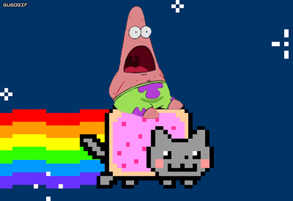
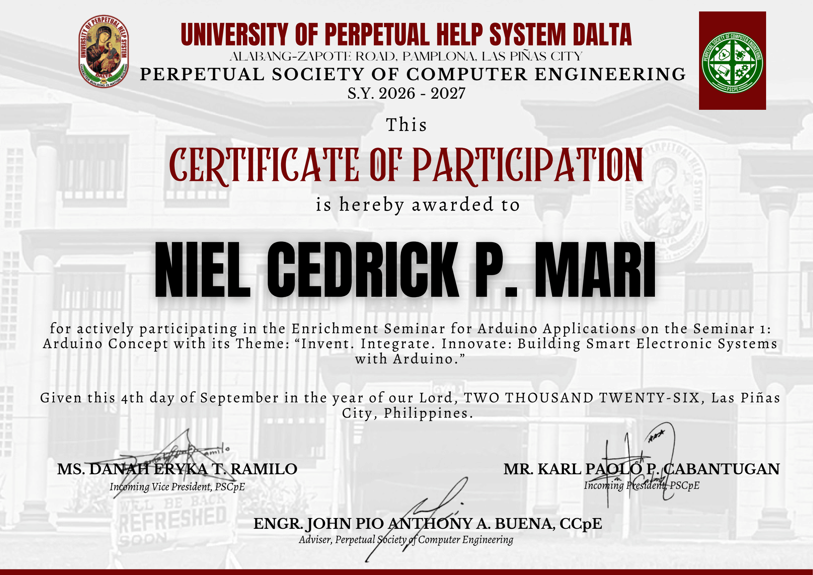
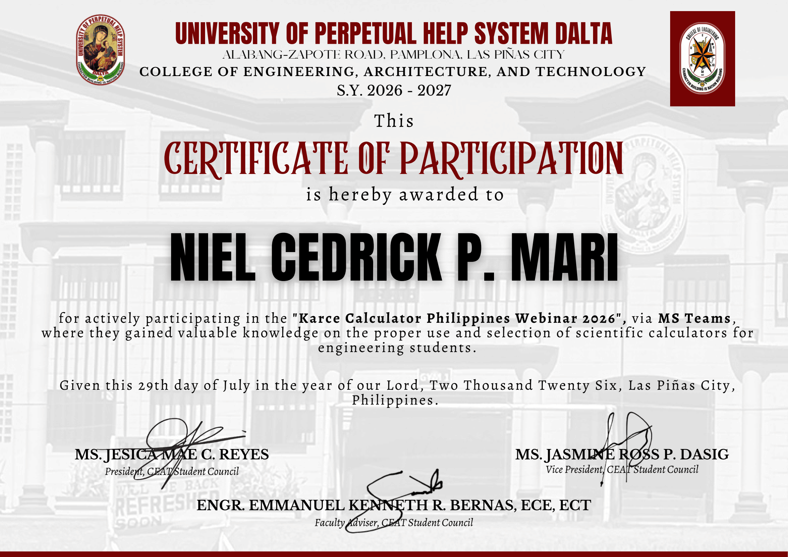
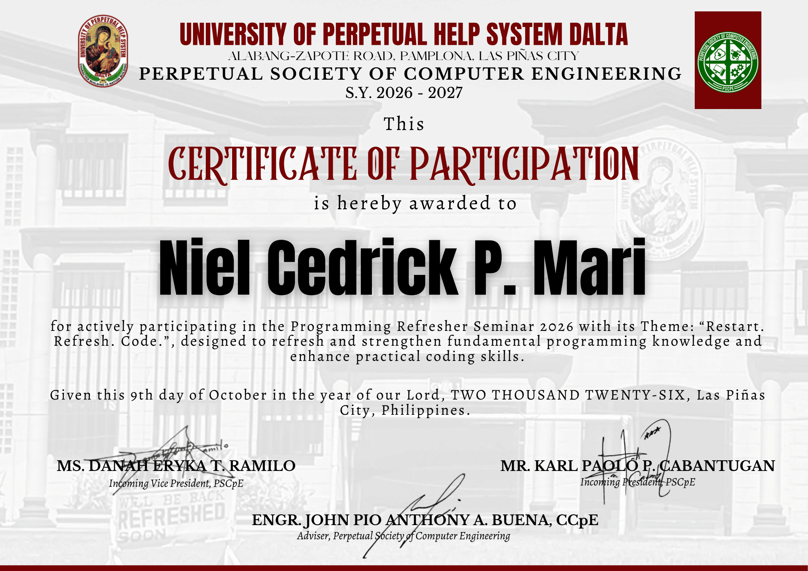
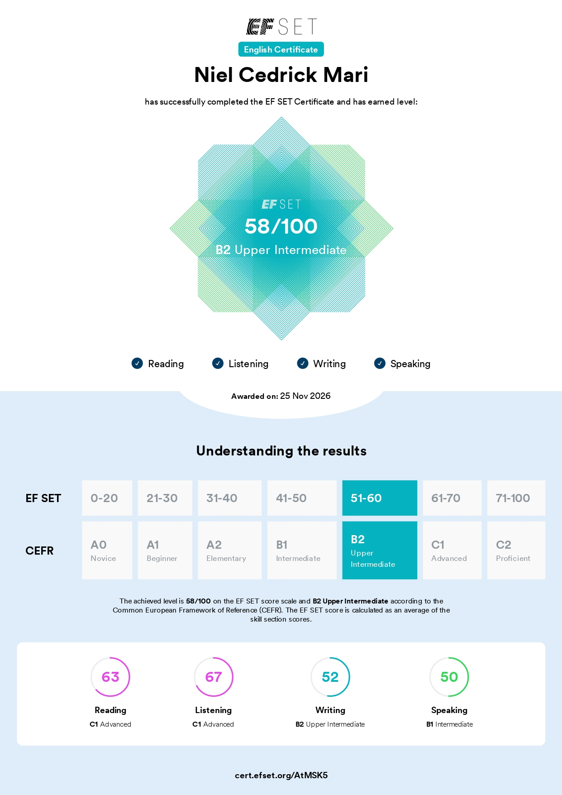
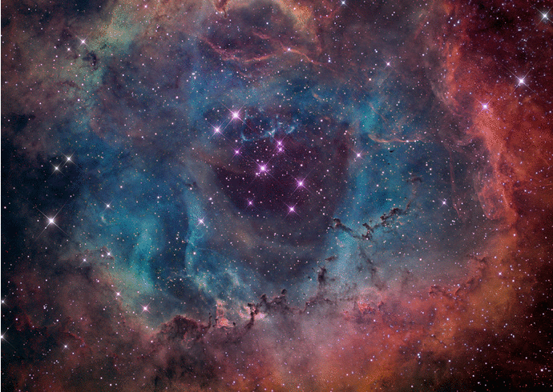

  
  <h1>Greetings, wanderer! 🧌 </h1>

### 🧑‍💻 Hey there, I'm Niel Cedrick P. Mari! 

📍 Based in the Philippines | 💡 Aspiring Network Engineer & Computer Engineering Student

*1st-Year BSCOME Student at University of Perpetual Help System DALTA (Las Piñas Campus)*

Welcome to my GitHub profile! I am an aspiring Network Engineer with a strong foundation in Java programming, hardware tech troubleshooting, and network configurations. I enjoy building practical software systems and exploring network infrastructure.

---

### 📜 Seminars, Certifications & Activities

* **Seminars Attended:**
  * UPHSD Programming Refresher (2026)
  * Arduino Concept of the Enrichment Seminar for Arduino Applications (2026)
  * Karcee Calculator Philippines Webinar (2026)
  * Professorial Lecture on Artificial Intelligence (2026)

  

    
 📄 Click for Seminar Certificates

     
    
    
    
  

* **Major Certifications:**

* **Minor Certifications:**
  * EF SET English Certificate (Nov, 2026)
 
  

    
 📄 Click for Minor Certifications

     
    
  

    

* **Hackathons:**
  * EdTek Con 2026 – Team GreenGrass

---

## 🛠️ Technologies & Tools

---

### 🌐 Let's Connect!

I'm always open to collaborating on interesting projects, software systems, or networking challenges. Feel free to reach out!

---
### 🕵 Fun Fact

I love watching documentaries and learning about space!

  

